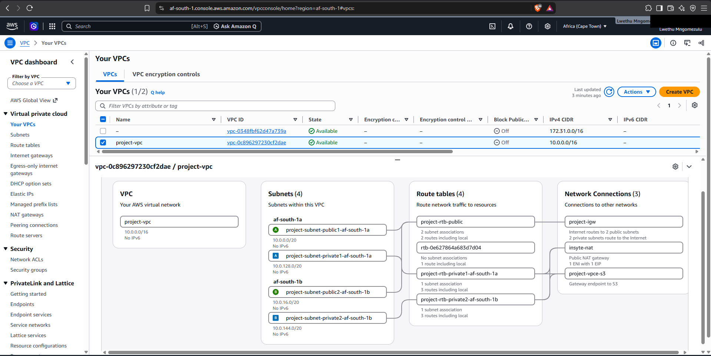
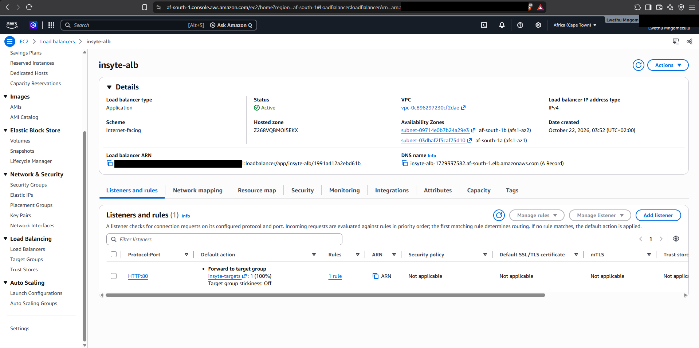
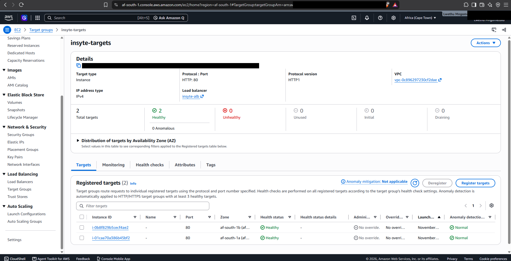
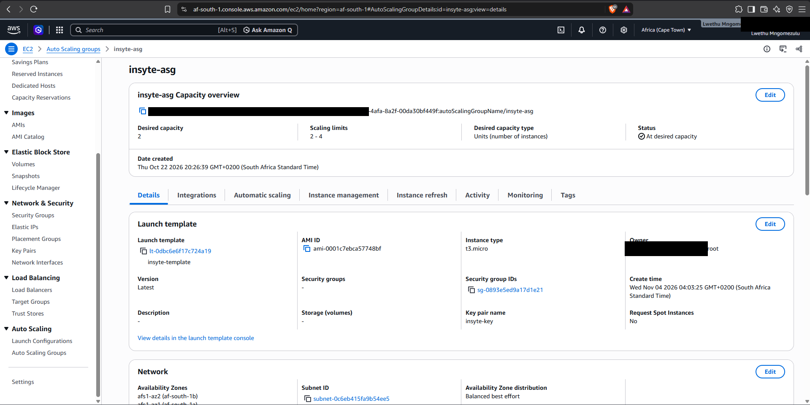
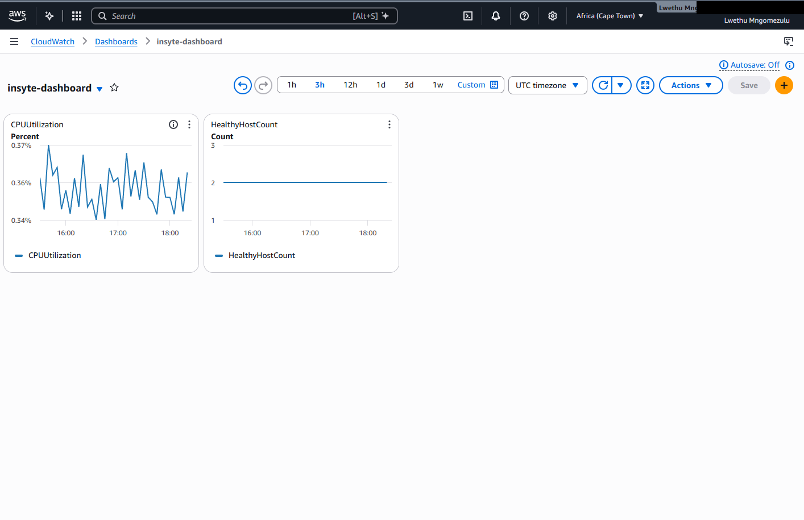
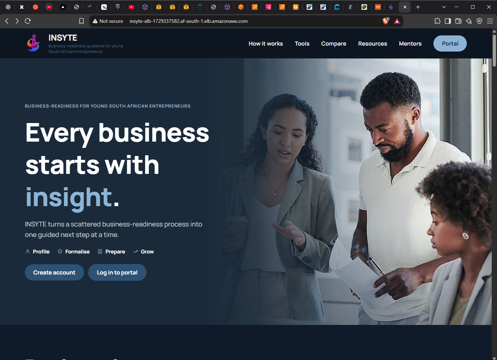
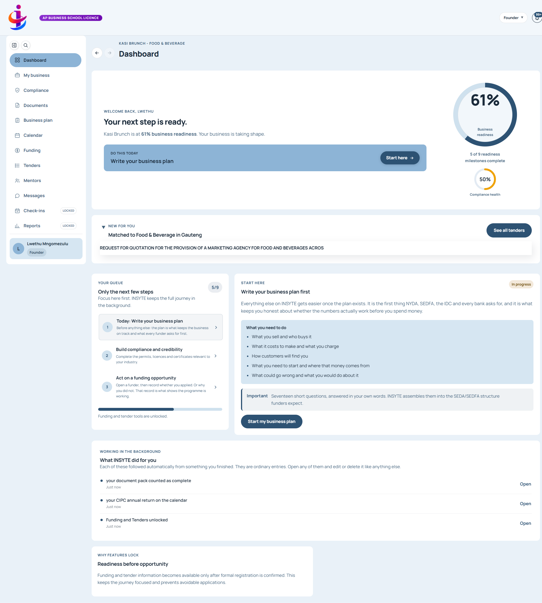

# INSYTE: Highly Available Web Application on AWS

A two-tier, highly available deployment of **INSYTE**, a business-readiness platform for young South African entrepreneurs, built on AWS in the **af-south-1 (Cape Town)** region to practise high availability, auto scaling and monitoring.

> **Note:** The environment was torn down after testing to avoid ongoing costs (the NAT gateway and RDS were the main cost drivers). The screenshots and demo recording below are the evidence of the working deployment. Account identifiers have been redacted.

## Architecture

Browser → Application Load Balancer (public subnets) → EC2 instances in an Auto Scaling group (private subnets) → RDS MySQL (private subnets)

| Layer | Detail |
|---|---|
| Network | Custom VPC `10.0.0.0/16` with 2 public and 2 private subnets across 2 Availability Zones (`af-south-1a`, `af-south-1b`) |
| Routing | Internet gateway for public subnets, NAT gateway for outbound access from private subnets, S3 gateway endpoint |
| Load balancing | Internet-facing Application Load Balancer, HTTP:80 listener forwarding to a target group with health checks |
| Compute | Launch template (t3.micro) and Auto Scaling group, desired capacity 2, min 2 / max 4, target-tracking policy at 70% CPU |
| Database | Managed RDS MySQL in private subnets |
| Access control | IAM role on instances, security groups between tiers, S3 for storage |
| Monitoring | CloudWatch alarms (unhealthy hosts, high CPU) and a dashboard (CPU, healthy host count) |

## Evidence

### Network design

Subnets across two Availability Zones, public and private route tables, internet gateway, NAT gateway and S3 endpoint.

### Load balancer and healthy targets

### Auto Scaling group

### Monitoring

CPU stays low with minimal traffic and both targets report healthy.

### The application served through the load balancer

The address bar shows the site loading from the load balancer's DNS name (HTTP only; no domain or SSL certificate was configured).

## Demo

[Screen recording of the site loading through the load balancer](demo/site-demo.mp4)

## Design decisions

- **Two Availability Zones:** the site stays up if one zone fails.
- **Private subnets for servers and database:** they are not directly reachable from the internet.
- **Auto Scaling group:** replaces failed instances and adds capacity under load.
- **NAT gateway:** lets private instances make outbound calls without being exposed.
- **CloudWatch alarms:** early warning for unhealthy hosts and high CPU.

## What I would improve

- Add HTTPS with a custom domain using Route 53 and AWS Certificate Manager
- Rebuild the infrastructure as code with Terraform or CloudFormation
- Add CI/CD for deployments
- Add an architecture diagram (draw.io) to `architecture/`

## Skills demonstrated

AWS (EC2, VPC, ALB, Auto Scaling, RDS, S3, IAM, CloudWatch, NAT gateway, security groups)
